<div align="center">


# HisabMitra (હિસાબમિત્ર)

**Smart Hisab, Happy Family. — સ્માર્ટ હિસાબ, ખુશ પરિવાર.**

Personal and family money manager for Android, in **English and Gujarati**.
Daily income and expenses, money lent and borrowed, family and trip
expense splitting, reports, bills, reminders and backups. Your hisab is
saved to your HisabMitra account (only you can see it), with a copy on the
phone so the app also works without internet.

[**⬇ Download HisabMitra**](https://hisab-mitra-web.vercel.app/download) · [Website](https://hisab-mitra-web.vercel.app) · [ગુજરાતી](https://hisab-mitra-web.vercel.app/gu)


</div>

## Screenshots

<table>
  <tr>
    <td align="center"><br><sub>Dashboard</sub></td>
    <td align="center">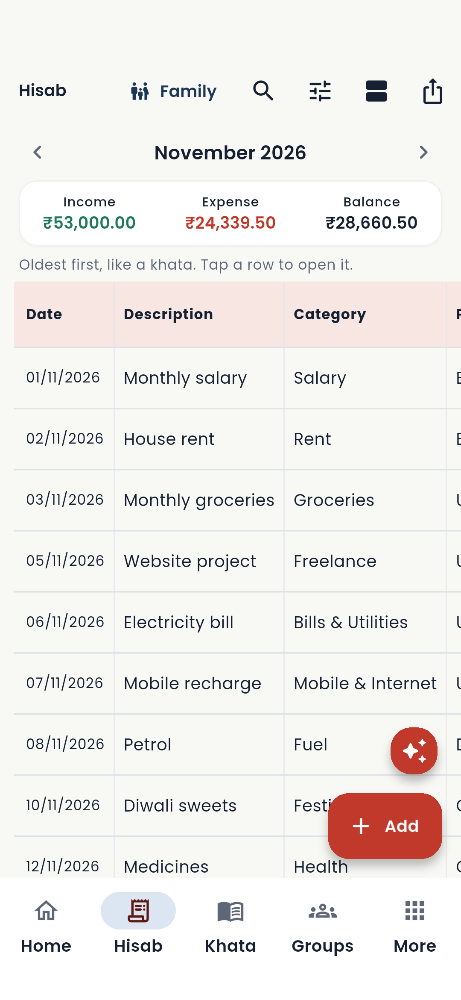<br><sub>Hisab as an Excel-like sheet</sub></td>
    <td align="center">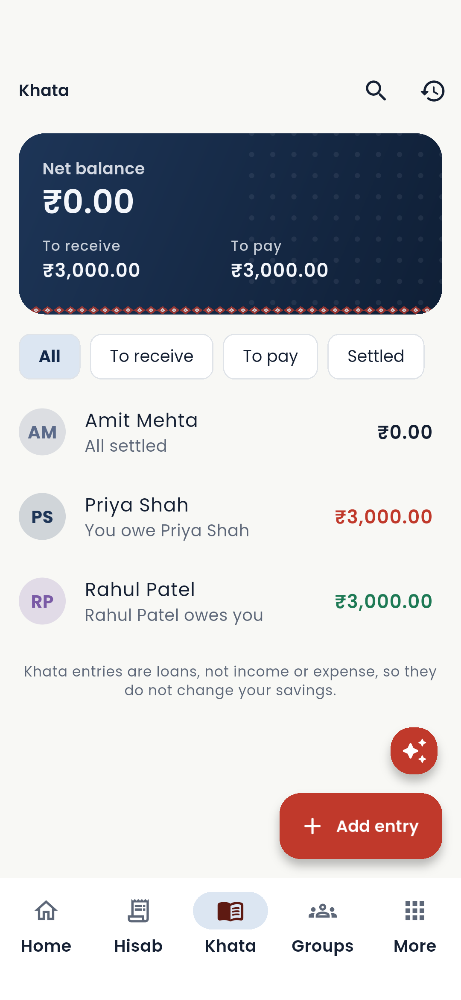<br><sub>Khata — people and loans</sub></td>
  </tr>
  <tr>
    <td align="center">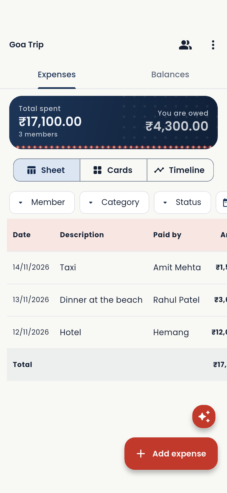<br><sub>Group expenses</sub></td>
    <td align="center">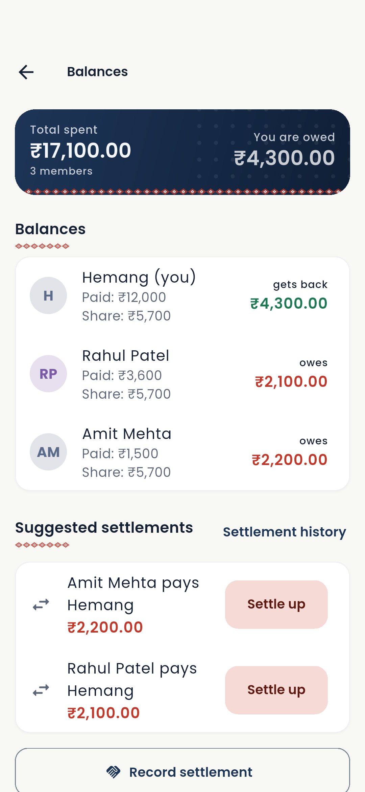<br><sub>Balances and settle-up</sub></td>
    <td align="center">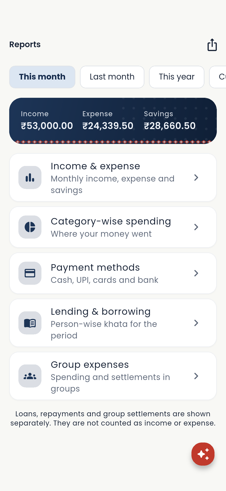<br><sub>Reports</sub></td>
  </tr>
  <tr>
    <td align="center">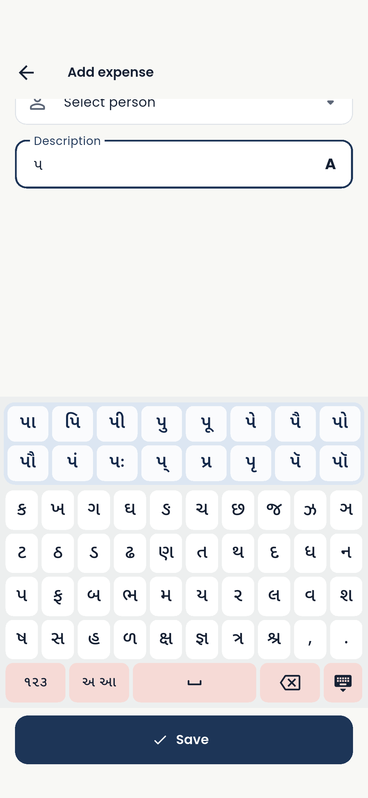<br><sub>Gujarati keypad (barakhadi row)</sub></td>
    <td align="center">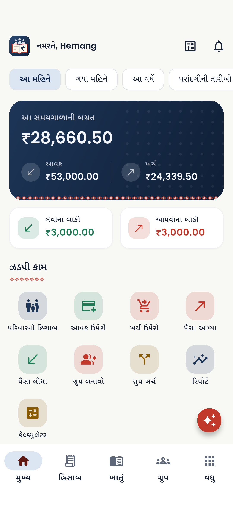<br><sub>Fully in Gujarati</sub></td>
    <td align="center">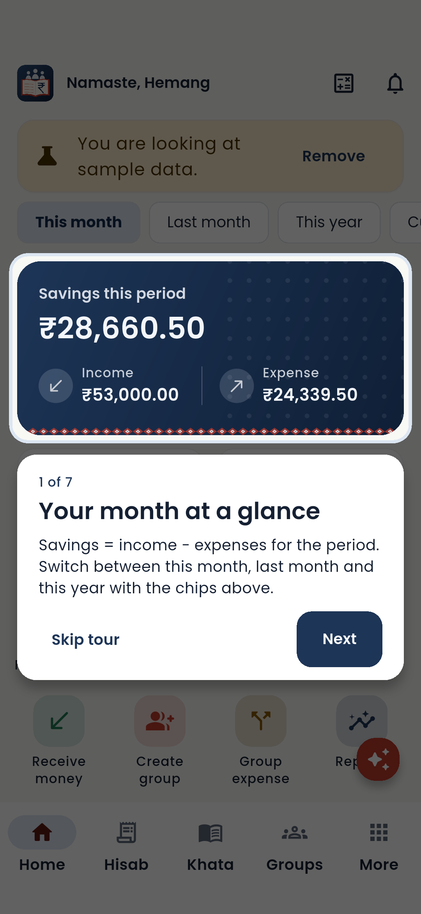<br><sub>First-run guided tour</sub></td>
  </tr>
  <tr>
    <td align="center">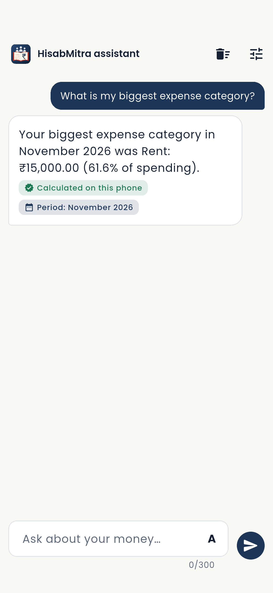<br><sub>The assistant answers from your hisab</sub></td>
    <td align="center">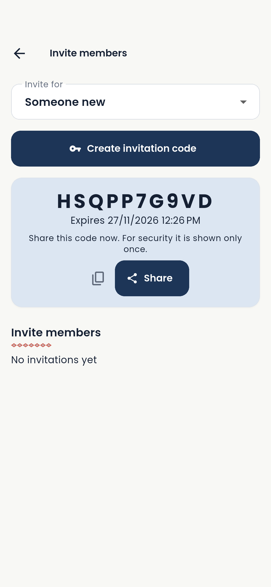<br><sub>Invite family with a link</sub></td>
    <td align="center">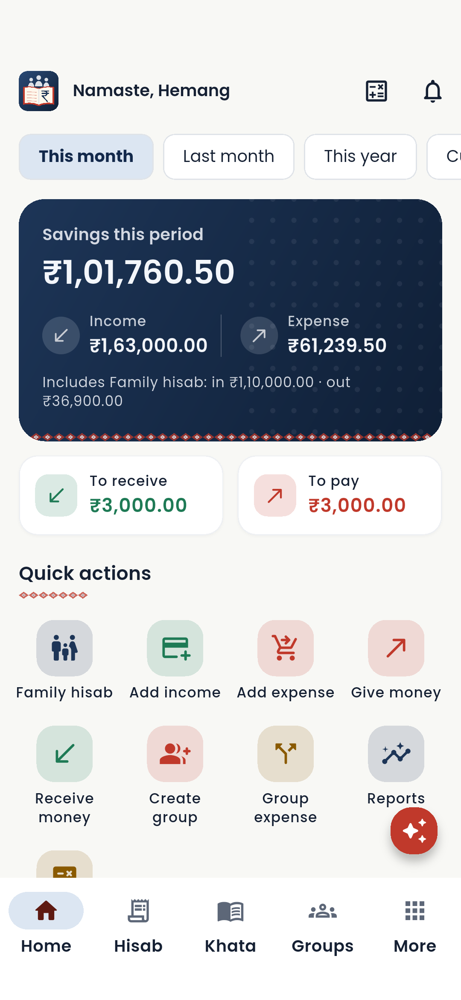<br><sub>Home screen includes Family hisab</sub></td>
  </tr>
  <tr>
    <td align="center">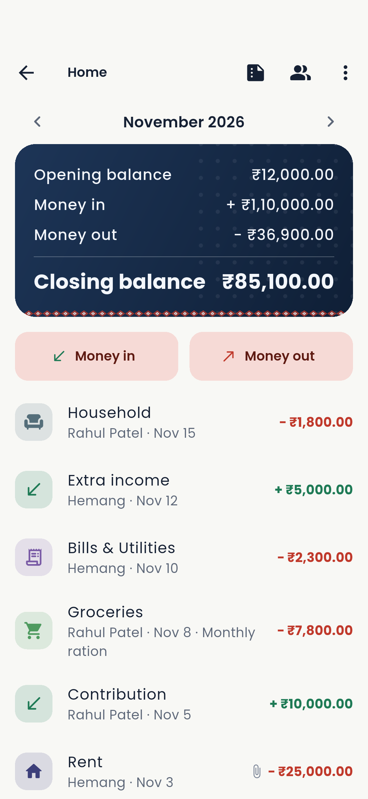<br><sub>Family hisab — the month's passbook</sub></td>
    <td align="center">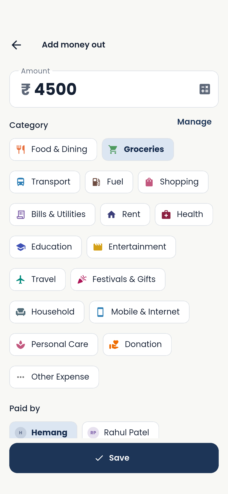<br><sub>Money out, with category and who paid</sub></td>
    <td align="center">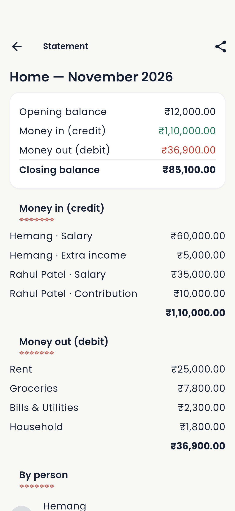<br><sub>Monthly statement (PDF, WhatsApp)</sub></td>
  </tr>
  <tr>
    <td align="center">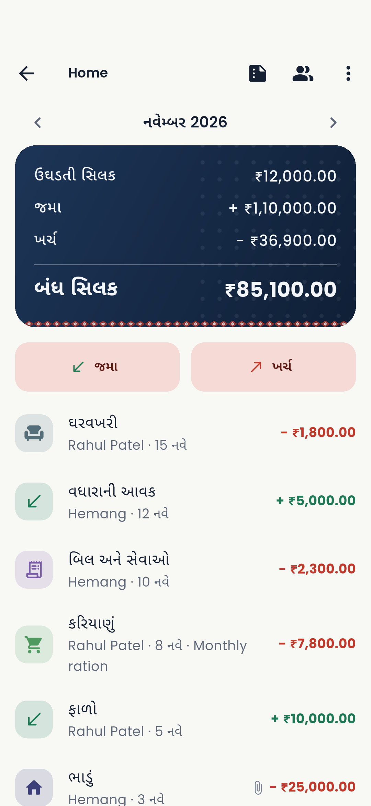<br><sub>પરિવારનો હિસાબ — in Gujarati</sub></td>
    <td align="center">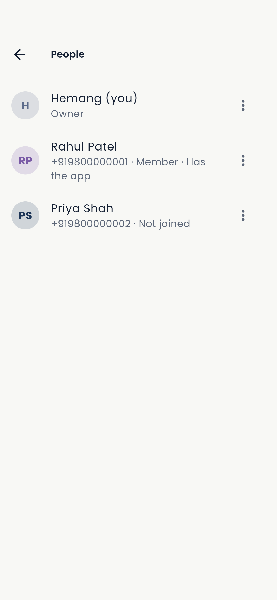<br><sub>People, with or without the app</sub></td>
    <td align="center">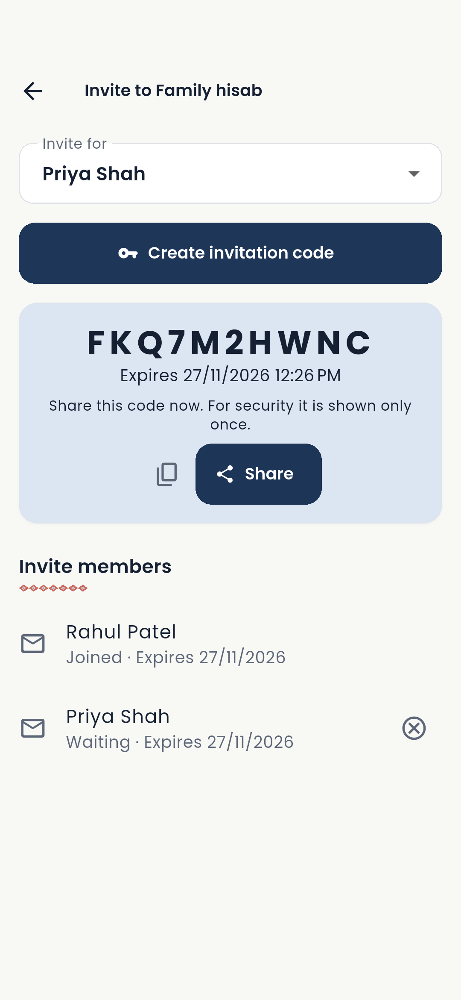<br><sub>Invite family to the Family hisab</sub></td>
  </tr>
</table>

<sub>Screenshots show the built-in sample data from the guided tour.</sub>

### Colour themes

<table>
  <tr>
    <td align="center">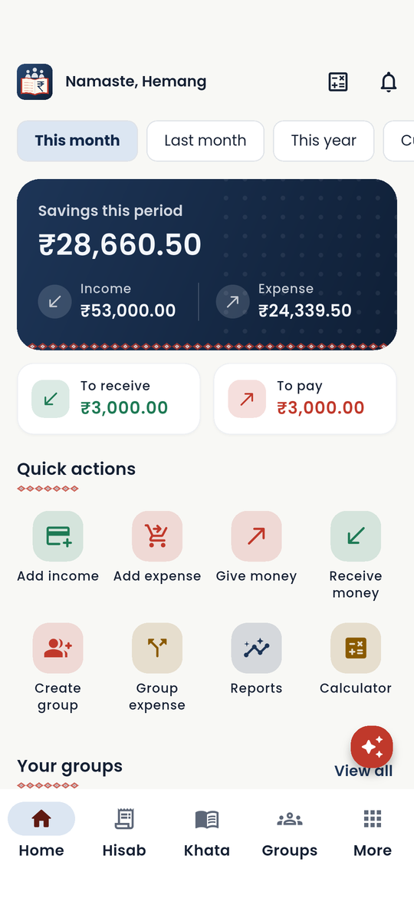<br><sub><b>Rann Utsav</b> (default)</sub></td>
    <td align="center">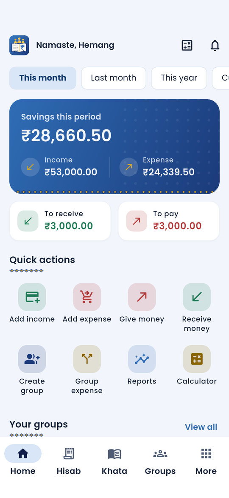<br><sub>Neel Gagan</sub></td>
    <td align="center">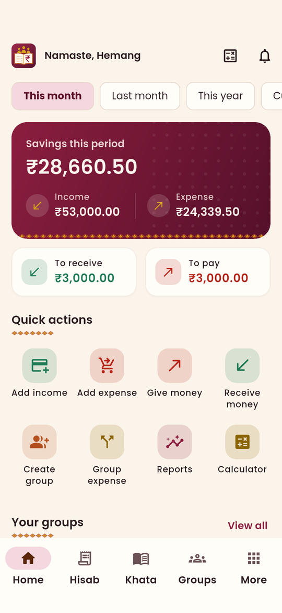<br><sub>Bandhani Lal</sub></td>
    <td align="center">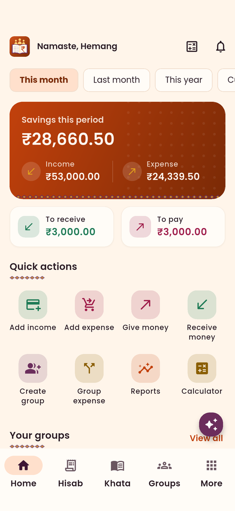<br><sub>Kesariyo</sub></td>
    <td align="center">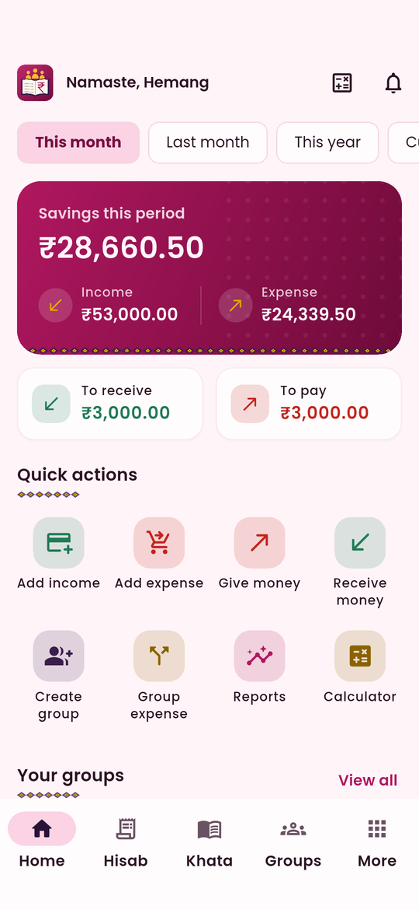<br><sub>Patola Rani</sub></td>
  </tr>
</table>

## Features

**Daily hisab**
- Income and expenses with categories (custom icons and colours, names in
  English and Gujarati), payment method, person, notes and bill photos or
  PDFs.
- Day-by-day list or an **Excel-like sheet** with Income, Expense and a
  running balance; search, filters, period switch (this month, last month,
  this year, custom).
- Dashboard with savings, money to receive / pay, quick actions, recent
  entries and a monthly income-vs-expense chart.
- Built-in calculator (unit price × quantity) with exact paisa arithmetic.

**Family hisab — the home's shared money (પરિવારનો હિસાબ)**
- One hisab for everyone who shares a home: people by name and mobile
  number (no app needed), money in (salary, extra income, contribution) and
  money out (category, who paid, bill photos). Nothing is split.
- A **passbook** month by month: opening balance, money in, money out,
  closing balance, carried forward; a monthly statement as **PDF** or
  **WhatsApp** text.
- Family members with the app join with a link and see changes live; the
  owner and admins manage, members add entries.
- The Home screen's figures and chart include it, with an "Includes Family
  hisab" line; the assistant answers questions about it; reminders can
  belong to it.

**Khata — money given and taken**
- Record money lent or borrowed per person, with due dates and **partial
  repayments**. Over-repayment is blocked (or saved as an advance).
- Loans never mix with income and expenses.
- People from your contacts (no contacts permission needed) or typed in.

**Groups — family, trips, events**
- Split expenses **equally, by exact amounts, percentages, ratios or
  adjusted shares**, among selected members. Splits always add up to the
  paisa.
- Balances, suggested settle-ups, full or partial settlements and history.
- Three views: sheet, cards and timeline.
- Optional cloud sharing with other members (single-use invite code;
  every change is permission-checked on the server).

**Reports, reminders, safety**
- Monthly, category, payment-method, person, group and settlement reports
  with charts; **PDF** (correct Gujarati shaping) and **CSV** (opens in
  Excel) export and share.
- Reminders for repayments, collections and recurring payments (EMI, SIP,
  rent).
- Everything is **saved to your account** and comes back on a new phone
  after sign-in; two phones on one account stay in sync.
- **Encrypted backup and restore** (AES-256) with checksum validation and
  an automatic safety backup before every restore. Restoring replaces the
  hisab saved in your account (groups and Family hisab are not changed).
- Optional AI assistant: answers from your own data on the phone; online
  wording only with your own API key and consent.

**Made for Gujarati families**
- Every screen in **English and Gujarati**.
- **Gujarati keypad**: type a consonant and its whole barakhadi (કા કિ કી કુ
  કૂ કે કૈ કો કૌ કં ક્) appears in the top rows; half letters in two taps
  (પુણ્ય, હર્ષ). English-to-Gujarati typing is also available.
- Five colour themes from Gujarati crafts and places: **Rann Utsav**,
  Neel Gagan, Bandhani Lal, Kesariyo and Patola Rani.
- A one-minute **guided tour with sample data** on first launch.

**Updates**
- New versions are offered inside the app (More → About → Check for
  updates). Each download is checked against its published SHA-256 and the
  app's signing certificate before Android asks you to install it.

## Privacy note for whoever runs the backend

Records are stored in the Supabase project this build is configured with.
Each account can only read its own records (row-level security), but the
project owner can see every user's records in the Supabase dashboard.
Anyone who installs the public APK stores their hisab in that project.

## Install

1. Download HisabMitra from the website:
   [hisab-mitra-web.vercel.app/download](https://hisab-mitra-web.vercel.app/download).
2. Open it on your Android phone (Android 7.0 or newer) and allow
   "install unknown apps" when asked.
3. Create your account: name, email and mobile number. Verify the email
   with the code you receive. After that the app works offline.

## Privacy

- Personal transactions, people, loans, reminders and bills are saved to
  **your own account** (only you can see them), with a working copy on the
  phone for offline use. Categories and settings stay on the phone.
- The account (name, email, mobile number) identifies you; group members
  see only your name, and only in groups they share with you.
- In plain words, in English and Gujarati:
  [hisab-mitra-web.vercel.app/privacy](https://hisab-mitra-web.vercel.app/privacy).
- Details: [docs/PRIVACY_AND_SECURITY.md](docs/PRIVACY_AND_SECURITY.md).

## For developers

| | |
|---|---|
| App | Flutter 3.47 · Dart 3.13 · Riverpod 3 · GoRouter · Material 3 |
| Local data | SQLite via Drift (schema v3, step-by-step migrations) |
| Cloud | Supabase: Auth (email OTP), PostgreSQL with Row Level Security, RPCs, Storage, Edge Function |
| Money | Integer paise everywhere — no floating point |
| Tests | 313 unit / widget / app-flow tests, on-device integration tests, 53 SQL security checks |
| CI/CD | GitHub Actions: checks on every push; signed APK release on every `v*` tag |

```bash
flutter pub get
cp dart_defines.example.json dart_defines.json   # Supabase URL + publishable key (optional)
flutter run --dart-define-from-file=dart_defines.json
```

Quality checks:

```bash
flutter analyze
flutter test
flutter test integration_test -d <device> --concurrency=1
bash tool/run_supabase_tests.sh   # needs Docker
```

Release: bump `version:` in `pubspec.yaml`, add
`docs/release-notes/vX.Y.Z.md`, then `git tag vX.Y.Z && git push origin vX.Y.Z`.
See [docs/GITHUB_RELEASE_GUIDE.md](docs/GITHUB_RELEASE_GUIDE.md).

### Documentation

| Topic | Document |
|---|---|
| Status and history | [PROGRESS](docs/PROGRESS.md) |
| Architecture and decisions | [ARCHITECTURE](docs/ARCHITECTURE.md), [TECHNICAL_DECISIONS](docs/TECHNICAL_DECISIONS.md) |
| Screens | [SCREEN_INVENTORY](docs/SCREEN_INVENTORY.md), [UI_DESIGN_SYSTEM](docs/UI_DESIGN_SYSTEM.md) |
| Money rules | [FINANCIAL_BUSINESS_RULES](docs/FINANCIAL_BUSINESS_RULES.md) |
| Database | [DATABASE_SCHEMA](docs/DATABASE_SCHEMA.md), [DATABASE_ERD](docs/DATABASE_ERD.md) |
| Cloud | [SUPABASE_SETUP](docs/SUPABASE_SETUP.md), [RLS_SECURITY](docs/RLS_SECURITY.md), [API_DOCUMENTATION](docs/API_DOCUMENTATION.md), [SYNC_ARCHITECTURE](docs/SYNC_ARCHITECTURE.md), [AUTHENTICATION_FLOW](docs/AUTHENTICATION_FLOW.md) |
| Features | [LOCALIZATION](docs/LOCALIZATION.md), [BACKUP_RESTORE](docs/BACKUP_RESTORE.md), [AI_ASSISTANT](docs/AI_ASSISTANT.md) |
| Testing and release | [TESTING_STRATEGY](docs/TESTING_STRATEGY.md), [DEPLOYMENT_GUIDE](docs/DEPLOYMENT_GUIDE.md), [GITHUB_RELEASE_GUIDE](docs/GITHUB_RELEASE_GUIDE.md) |

## License

[MIT](LICENSE)
