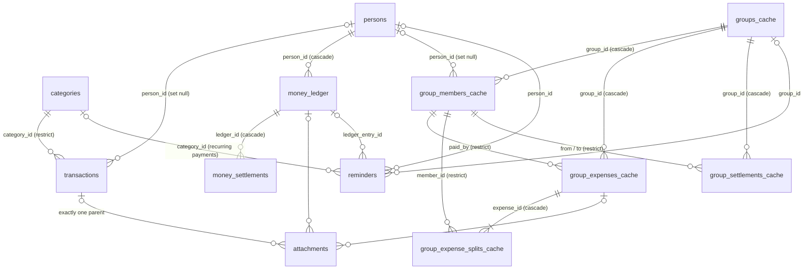
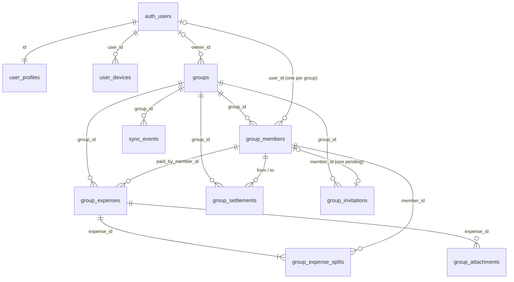

# Entity Relationship Diagrams

Column details: `DATABASE_SCHEMA.md` (local, generated) and
`supabase/migrations/` (cloud).

## Local SQLite (Drift, schema v2)

Stand-alone tables: `local_user_profile`, `app_settings`, `backup_history`,
`sync_outbox`, `sync_inbox`, `sync_conflicts` (linked to groups by
`group_id` value, not by foreign key, so queued operations survive local
deletes).

## Cloud (Supabase PostgreSQL)

`processed_ops` (idempotency log) has no foreign keys and no client access.

Local ↔ cloud mapping: `groups_cache` ↔ `groups`, `group_members_cache` ↔
`group_members`, `group_expenses_cache` + `group_expense_splits_cache` ↔
`group_expenses` + `group_expense_splits`, `group_settlements_cache` ↔
`group_settlements`. Ids are identical on both sides (client UUIDs).
Personal tables have no cloud counterpart.
